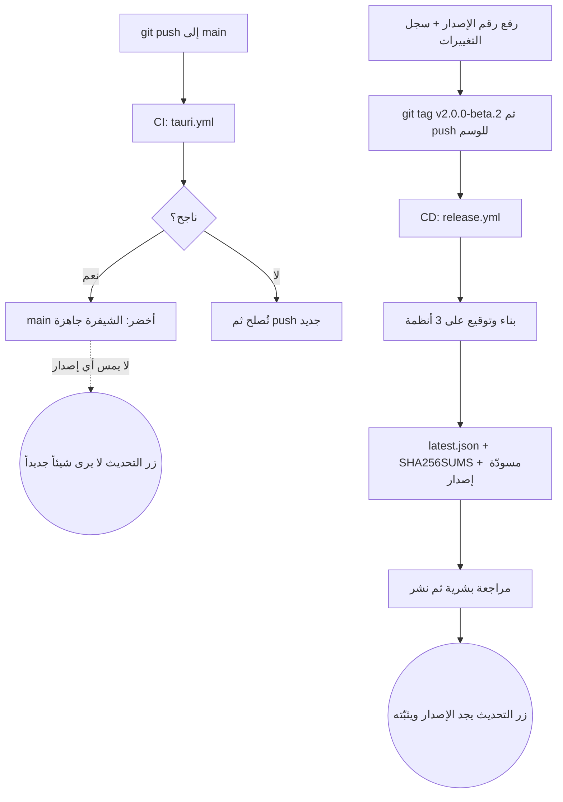

# التكامل المستمر والتسليم المستمر (CI / CD) في PickerHub

دليل تعليمي: ما معنى CI وCD، وكيف بُنيا في هذا المشروع، وما الذي أضافاه، ولماذا لا يصل الـ push وحده إلى زر **التحقق من التحديثات**.

## 1. المفهومان باختصار

**التكامل المستمر (Continuous Integration — CI):** كل تغيير يُرفع إلى المستودع يُبنى ويُختبر تلقائياً على أجهزة نظيفة، لا على جهاز المطوّر وحده. الهدف أن يُكتشف الخطأ بعد دقائق من كتابته، وأن يبقى الفرع الرئيسي `main` صالحاً للبناء في كل لحظة.

**التسليم المستمر (Continuous Delivery — CD):** خطوة بعد CI: تحويل نسخة سليمة من الشيفرة إلى منتج جاهز للتوزيع (مثبّتات موقّعة، ملف تحديث، ملاحظات إصدار) بأمر واحد وبالطريقة نفسها في كل مرة، بلا خطوات يدوية تُنسى.

وهناك مصطلح قريب: **النشر المستمر (Continuous Deployment)**، حيث يصل كل تغيير ناجح إلى المستخدمين تلقائياً دون تدخل بشري. PickerHub **لا** يعمل بهذا الأسلوب عن قصد، كما سيأتي في القسم 5.

| | يجري عند | ينتج | يصل إلى المستخدم؟ |
| --- | --- | --- | --- |
| CI | كل push وكل pull request | حكم: ناجح أو فاشل، ونسخ تجريبية للفحص | لا |
| CD (تسليم) | دفع وسم إصدار مثل `v2.0.0-beta.2` | إصدار مسودّة كامل وموقّع | بعد أن يراجعه شخص وينشره |
| Deployment (نشر) | كل تغيير ناجح | نسخة منشورة فوراً | نعم، تلقائياً (غير مستعمل هنا) |

## 2. كيف بُني ذلك في هذا المشروع

كل ما يلي ملفات YAML في `.github/workflows/` تشغّلها GitHub Actions على أجهزة افتراضية لكل نظام.

### CI: ملف `tauri.yml` (اسمه في GitHub: PickerHub 2 (Tauri))

يجري عند كل push وكل pull request، على ثلاثة أنظمة معاً: Ubuntu 24.04 وWindows وmacOS 15. في كل نظام:

1. تثبيت الأدوات (Node وRust ومكتبات WebKitGTK على لينكس).
2. فحص الواجهة: `npm run check` (الأنواع وتحذيرات Svelte)، و`npm test` (اختبارات الوحدة)، و`npm run build`.
3. `cargo test --workspace`: اختبارات Rust للنواة والمخزن (ومنها توافق مكتبات 1.x) والالتقاط والتطبيق.
4. على لينكس فقط، فحوص حقيقية داخل شاشة افتراضية (Xvfb):
   - التقاط X11 حقيقي.
   - اختبار طرفي (end to end) في `tests/e2e_pick.sh`: يشغّل التطبيق، يضغط F8 ثم اختصاراً عاماً، وينقر نافذة لونها معروف، ويتأكد أن اللونين وصلا إلى السجل المحفوظ.
   - `tests/ui_tauri.py`: صور لكل صفحة بالعربية والإنجليزية وبالسمتين، وفحص سياسة أمان المحتوى (CSP)، وتدقيق إتاحة بـ axe-core.
5. بناء الحزم (`tauri build`) ورفعها كمخرجات للفحص اليدوي.

ويجري معه عمل `supply-chain`: يفحص تبعيات Rust وnpm بحثاً عن ثغرات معروفة وتراخيص غير مقبولة.

### CD: ملف `release.yml` (اسمه: PickerHub release)

لا يجري مع كل push، بل فقط عند دفع **وسم** يبدأ بـ `v` (أو يدوياً). يعمل على مرحلتين:

1. **build** على الأنظمة الثلاثة:
   - يرفض البدء إن غاب مفتاح التوقيع (`PICKERHUB_UPDATER_PUBKEY` و`TAURI_SIGNING_PRIVATE_KEY`).
   - يبني نسخة الإصدار بإعدادات `tauri.release.conf.json` ومع ميزة `updater`، ويمرّر المفتاح العام إلى إعداد إضافة التحديث.
   - يوقّع كل ملف تحديث بتوقيع minisign (ملفات `.sig`)، ويوقّع مثبّتات Windows وmacOS بشهادات النظام إن وُجدت.
   - على لينكس يعطي حزمة Debian اسمها النهائي `pickerhub` ويوقّعها من جديد (`scripts/release_deb.py`).
2. **publish**:
   - يكتب `latest.json`، أي بيان التحديث الذي يقرؤه التطبيق (`scripts/latest_json.py`).
   - يكتب `SHA256SUMS` بأسماء الملفات كما تُنزَّل.
   - ينشئ إصداراً **مسودّة** على GitHub فيه كل شيء.

### ملف مؤرشف: `.github/workflows-archive/check.yml`

كان CI وإصدارات المعاينة لنسخة 1.x المبنية بـ Avalonia. بعد صدور 2.0.0-beta.1 نُقل خارج `.github/workflows`، فلم تعد GitHub تشغّله. ويمكن إعادته بأمر `git mv` واحد مكتوب في رأسه.

## 3. ما الذي كشفه CI وأصلحناه في هذا العمل

هذا القسم مثال حي على فائدة CI: كل مشكلة هنا كانت ستصل إلى المستخدمين أو تعطّل الإصدار لولا الفحص التلقائي.

| المشكلة | كيف ظهرت | الإصلاح |
| --- | --- | --- |
| فشل إصدار 2.0.0-beta.1 عند فحص التوقيع | `pubkey` فارغ في `tauri.conf.json`، والمفتاح كان يصل إلى شيفرة Rust وحدها عبر متغير البيئة | مرحلة البناء تكتب المفتاح العام في ملف إعداد إضافي وتمرّره إلى `tauri build` بـ `--config` |
| فشل البناء على Windows وmacOS | `cargo test` يبني الأمثلة أيضاً، ومثالان في `crates/capture` يستعملان X11 الموجود على لينكس وحده | شيفرة X11 في المثالين صارت داخل وحدة خاصة بلينكس، و`main` فارغة على غيره |
| فشل متقطع في الاختبار الطرفي على لينكس | الاختبار كان ينقر مرة واحدة بعد 4.5 ثانية ثابتة، فإذا تأخر التطبيق في البدء فاتته النقرة | `x11_click` ينقر كل ثانية حتى يظهر لون في السجل المحفوظ (30 ثانية حداً أقصى)، وأوامر الاختبار تنتظر جاهزية الواجهة |
| فشل عمل الإصدار القديم مع كل push | `check.yml` كان يحاول إنشاء الإصدار `v1.2.0` الموجود أصلاً | يتخطى الإصدار إن وُجد، ثم أُرشف الملف كله |
| `sha256sum -c` يفشل عند المستخدم | `SHA256SUMS` كان يذكر مسارات البناء (`release/bundle/deb/...`) بدل أسماء التنزيل | تُحسب البصمات من مجلد كل ملف، ويُرفض الإصدار إن تكرر اسم ملف |

ولاحظ أن الاختبار الطرفي نجح على فرع ثم فشل على فرع آخر **للشيفرة نفسها**. هذا ما يسمى الاختبار المتذبذب (flaky test)، وسببه هنا افتراض توقيت ثابت. علاجه الصحيح أن ينتظر الاختبار نتيجة يمكن ملاحظتها (لون في السجل)، لا أن تُزاد مدة الانتظار.

## 4. فائدة CI / CD

- **اكتشاف الخطأ مبكراً وفي مكانه:** يفشل الفحص عند التغيير الذي سبّب المشكلة، فيُعرف السبب فوراً بدل البحث عنه بعد أسابيع.
- **ثلاثة أنظمة في كل مرة:** المطوّر يعمل على لينكس، لكن كل تغيير يُبنى ويُختبر على Windows وmacOS أيضاً. خطأ أمثلة X11 مثال مباشر: ما كان ليظهر على جهاز لينكس.
- **بيئة نظيفة قابلة للتكرار:** لا يعتمد البناء على مكتبة مثبتة صدفة على جهاز المطوّر.
- **أمان التحديثات:** المفتاح الخاص يبقى في أسرار GitHub ولا يلمس أي جهاز، وكل ملف تحديث يوقَّع بالطريقة نفسها دائماً. والتطبيق يرفض أي ملف لا يطابق توقيعه المفتاح المدمج فيه.
- **إصدار بلا خطوات منسية:** أسماء الحزم، والتوقيعات، و`latest.json`، و`SHA256SUMS` تُكتب بالشيفرة نفسها في كل إصدار.
- **ثقة في `main`:** ما دام CI أخضر، فـ `main` قابل للإصدار في أي لحظة.

## 5. لماذا لا يكفي push واحد ليصل التحديث عبر زر «التحقق من التحديثات»؟

لأن الزر لا ينظر إلى الشيفرة ولا إلى الفرع `main` إطلاقاً. هذا ما يفعله بالضبط (`src-tauri/src/update.rs`):

1. يطلب ملفاً واحداً فقط:
   `https://github.com/hussamty/PickerHub/releases/latest/download/latest.json`
   أي ملف `latest.json` من **آخر إصدار منشور** على GitHub.
2. يقارن رقم الإصدار في الملف برقم النسخة المثبتة. فإن لم يكن أحدث، قال إن النسخة محدّثة.
3. إن كان أحدث، نزّل ملف التحديث لنظامك، ولا يثبّته إلا إذا طابق توقيعُه المفتاحَ العام المدمج في التطبيق، وكان التوقيع للإصدار نفسه الذي أعلنه البيان.

والآن قارن ذلك بما يفعله push إلى `main`:



إذن الـ push يغيّر **الشيفرة** فقط، والتحديث يحتاج **منتجاً منشوراً**. وبينهما أربع حلقات لا يصنعها push عادي:

1. **رقم إصدار جديد:** النسخة المثبتة 2.0.0-beta.1. لو بُنيت الشيفرة الجديدة بالرقم نفسه، لما رآها التطبيق أحدث. لذلك يُرفع الرقم في `src-tauri/Cargo.toml` و`src-tauri/tauri.conf.json` و`ui/package.json`.
2. **وسم (tag):** `release.yml` لا يبدأ إلا عند دفع وسم `v*`. وهذا مقصود: ليس كل تغيير في `main` يستحق أن يصير إصداراً.
3. **بناء موقّع:** نسخ CI غير موقّعة بمفتاح التحديث، والتطبيق يرفض أي ملف بلا توقيع صحيح. التوقيع لا يحدث إلا في `release.yml` حيث المفتاح الخاص.
4. **نشر المسودّة:** `latest/download` يشير إلى آخر إصدار **منشور**، والمسودّة غير مرئية للتطبيق. النشر قرار بشري بعد تجربة المثبّتات (`docs/beta-checklist.md`).

### لماذا هذا التصميم أفضل من التحديث مع كل push؟

- **لا يصل نصف عمل إلى المستخدمين:** قد يحتوي `main` على ميزة بدأت ولم تكتمل، أو تغيير يحتاج تجربة على جهاز حقيقي.
- **التحديث لا يُسحب:** من ثبّت إصداراً سيئاً لا يمكن استرجاعه منه، بل يُصلح بإصدار أحدث. لذلك يمر كل إصدار بعين بشرية قبل نشره.
- **حماية المستخدم:** لو كان كل push يصل إلى الناس، لصار أي خطأ في المستودع أو حساب مخترق طريقاً مباشراً إلى أجهزتهم. الوسم والتوقيع والنشر اليدوي ثلاثة حواجز.
- **وضوح الإصدارات:** لكل إصدار رقم وملاحظات وبصمات، فيعرف المستخدم ما الذي تغيّر.

### وماذا عن مستخدمي 1.2.0؟

لا يحتوي 1.x على أي آلية تحديث، ولا يتصل بالشبكة أصلاً. لذلك ينتقلون إلى 2.x مرة واحدة يدوياً من صفحة الإصدار، ومن بعدها يتكفل زر التحديث بالباقي. ومكتبة الألوان تنتقل معهم: 2.x يفتح مجلد المكتبة نفسه، ويحفظ نسخة من مكتبة 1.x قبل أول كتابة.

## 6. الخطوات العملية لإصدار تحديث

1. اجعل CI أخضر على `main`.
2. ارفع رقم الإصدار في الملفات الثلاثة، وأضف قسماً في `CHANGELOG.md`.
3. نفّذ commit وpush إلى `main`، وانتظر نجاح CI.
4. أنشئ الوسم وادفعه:

   ```bash
   git tag -a v2.0.0-beta.2 -m "PickerHub 2.0.0-beta.2" && git push origin v2.0.0-beta.2
   ```

5. انتظر انتهاء `release.yml`، وافتح المسودّة: المثبّتات وملفات `.sig` و`latest.json` و`SHA256SUMS`.
6. جرّب المثبّتات على أجهزة حقيقية، ومنها التحديث من الإصدار السابق عبر الزر.
7. اكتب الملاحظات وانشر. من هذه اللحظة يجد زر التحديث الإصدار الجديد.

التفاصيل الكاملة، ومنها إعداد المفاتيح والشهادات، في `docs/release.md`.
